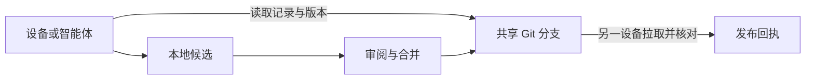

# Shared Facts

让 Windows、macOS 和不同智能体读取同一份经过审核的任务状态，并知道自己读的是哪个 Git 版本。

例如，Windows 上的智能体提议把任务标成「已完成」。审核期间，Mac 上的智能体仍读到旧状态。合并后，Mac 从上游取回新状态，并报告记录 ID 和 commit SHA。



## 先跑一次演练

下载或克隆本仓库，打开仓库目录。只需要 Git 和 Python 3.12 或更新版本。

| 系统 | 命令 |
| --- | --- |
| Windows | `py -3 demo.py` |
| macOS / Linux | `python3 demo.py` |

演练在本机创建两个临时 Git 克隆，模拟审核合并。无需 GitHub 账号、MCP、域名或模型 API。结果应包含以下字段，SHA 每次运行可能不同：

| 输出 | 含义 |
| --- | --- |
| `id: intake` | 两个克隆检查同一条合成记录。 |
| `before_merge.status: unpublished` | 候选分支已经推送，发布分支仍指向旧版本。 |
| `after_merge.status: verified` | 第二个克隆已取回合并后的版本，并核对 SHA 和记录内容。 |

## 适用场景与边界

- 适合需要交接明确状态的个人或小团队，例如任务进度、交付检查、经过审核的决策。每条记录包含状态、摘要和证据 ID。
- 脚本检查记录格式、候选冲突和读回版本。证据内容由审阅者核对；多人部署应在数据仓库配置分支规则来约束直接写入。
- 文件备份、全文知识库和会话记忆可以继续使用各自的工具。实际部署用独立的私有数据仓库，只提交获准共享的摘要和证据 ID。

## 部署到自己的设备

Windows 运行 `.\setup.cmd`，macOS/Linux 运行 `sh ./setup.sh`。只需共享已发布记录时，先用 Git 克隆；需要在智能体里调用时再选择只读 MCP。安装入口可以用 `--json` 返回选型与下一步。

| 目标 | 入口 |
| --- | --- |
| 下载后安装、选型与生成配置 | [下载与安装](docs/quick-setup.md) |
| 让智能体协助部署或维护 | [AGENTS.md](AGENTS.md) |
| 接入第二台设备、审核发布或排查故障 | [部署手册](docs/deployment.md) |
| 接入 Codex、Claude Code、Antigravity、Kimi、DeepSeek、Muse 或浏览器端 | [智能体接入](docs/agents.md) |
| 配置域名、隧道、身份认证或设备远控 | [远程接入](docs/remote.md) · [设备远控和 DevSpace](docs/devices.md) |
| 确认测试覆盖和需要自行验收的部分 | [验收标准](docs/acceptance.md) |

## 贡献与测试

遇到问题可以开 Issue，附操作系统、使用的接入路线、命令、期望结果和脱敏后的实际输出。涉及真实记录时用合成数据重现，保留凭据和原始记录在本地。提交代码或文档 PR 时说明变更目的和验证结果。

完整测试含 MCP，建议在 Python 虚拟环境中执行：

```sh
python -m pip install -r requirements-mcp.txt
python -m unittest discover -s tests -v
```

## English

Shared Facts is an agent-first reference implementation for sharing reviewed records across devices. One Git branch owns the published version of each record. An agent can prepare a candidate offline, reconcile it after reconnecting, submit it for review, and confirm it by fetching the merged record from another clone. The optional MCP adapter exposes allowlisted records through stdio or authenticated Streamable HTTP.

Run `python demo.py` with Git and Python 3.12+ to see an unpublished proposal become a verified record using two temporary local clones. The demo uses synthetic data and simulates review locally. For your own devices, start with the [setup launcher](docs/quick-setup.md), [agent instructions](AGENTS.md), and [deployment and troubleshooting](docs/deployment.md). See [acceptance](docs/acceptance.md) for the checks that require real devices and clients.

Licensed under [MIT](LICENSE).
