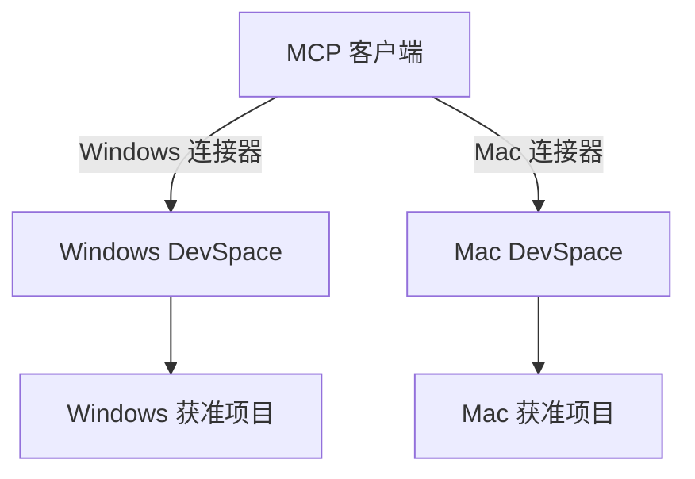

# 设备远控和 DevSpace 工作区

先选要操作的对象。给智能体看一条已发布事实、在 Mac 的项目里跑测试、从 Windows 控制 Mac 的鼠标键盘，是三条不同的访问路径。

| 目标 | 从哪里连到哪里 | 选择 |
| --- | --- | --- |
| 共享已审核的项目状态 | 任意设备或 Agent → 私有 Git 发布分支 | Git、GitHub 只读连接器或 Shared Facts MCP |
| Windows 上的 Agent 操作 Mac 或另一台笔记本的指定项目 | Windows 上的 MCP 客户端 → 目标设备的 DevSpace → 获准工作区 | 各设备各开一个连接器，分别授权 |
| 人从 Windows 操作 Mac 文件与终端 | Windows → Mac | OpenSSH / SFTP |
| 人从 Windows 操作 Mac 桌面 | Windows → Mac | macOS 屏幕共享及兼容的 VNC 客户端，经私网连接 |
| 人从 Windows 操作 Windows 笔记本桌面 | Windows → Windows | 远程桌面 RDP，目标机须支持充当 RDP 主机 |

## Windows 直接连接笔记本

1. **连私网。** 两台受控设备加入同一个 Tailscale tailnet。记录目标的 MagicDNS 名称。按实际用途用 grants 收窄到获准发起方、目标设备和 TCP 端口，并核对既有规则的权限叠加。主机防火墙另行限制本地网络的访问范围。无需买域名或在路由器做公网端口转发。
2. **Windows → Mac 终端。** 在 Mac 的「系统设置 → 通用 → 共享」开启「远程登录」，选择「仅这些用户」。给专用操作账户配置 SSH 公钥，核验首次连接时的主机指纹，保留全磁盘访问关闭。在 Windows PowerShell 使用 OpenSSH Client：

   ```powershell
   Test-NetConnection macbook -Port 22
   ssh mac-operator@macbook 'uname -s; hostname'
   ```

   命令在目标 Mac 上应返回 `Darwin` 和预期主机名。传文件可使用 `sftp mac-operator@macbook`。请把示例设备名和账户换成自己的值。
3. **Windows → Mac 桌面。** 在 Mac 同一个「共享」面板启用「屏幕共享」，限定访问人员。如果 Windows 客户端需要传统 VNC 兼容，开启允许 VNC 客户端用密码控制的选项，使用专用密码。Windows 的 VNC 客户端连接 Mac 私网地址的 TCP 5900。Apple 提醒第三方 VNC 的保护较弱，整个路径使用受限私网，同时约束 Mac 在局域网的监听访问。连接后用一个测试窗口确认能看到屏幕并操作鼠标键盘。
4. **Windows → Windows 笔记本桌面。** 在目标机「设置 → 系统 → 远程桌面」开启 RDP，授权指定账户，保留网络级别身份验证。Windows Professional、Enterprise、Education 可作主机，Home 可作为客户端。从 Windows 主机执行 `mstsc /v:win-laptop`，通过私网连接，目标 TCP 3389。登录后在目标桌面核对 `hostname`。
5. **重启和睡眠验收。** 先在目标设备开机在线时验证。再分别检查锁屏、休眠或重启后是否还能连接，并记录哪些场景需要现场唤醒或解锁。若目标不在线，先查电源、联网和 Tailscale 状态。若网络通但端口不通，查目标服务与防火墙。撤回访问时关闭不用的共享服务并删除对应 grants。

来源：[Tailscale Grants](https://tailscale.com/docs/features/access-control/grants) · [Apple 远程登录](https://support.apple.com/guide/mac-help/allow-a-remote-computer-to-access-your-mac-mchlp1066/mac) · [Apple 屏幕共享](https://support.apple.com/guide/mac-help/turn-mac-screen-sharing-on-or-off-mh11848/mac) · [Apple 的 VNC 说明](https://support.apple.com/guide/remote-desktop/virtual-network-computing-access-and-control-apde0dd523e/mac) · [Microsoft 远程桌面](https://learn.microsoft.com/windows-server/remote/remote-desktop-services/remotepc/remote-desktop-allow-access) · [Windows OpenSSH](https://learn.microsoft.com/windows-server/administration/openssh/openssh_install_firstuse)。

## 给 Agent 接入 DevSpace

DevSpace 在**被访问的设备**上运行。Windows 上的 Codex 等 Agent 要访问 Mac 项目，就注册 Mac 端的 MCP 地址。要访问另一台 Windows 笔记本，则注册那台笔记本自己的地址。为两个连接器分别设置凭据、工作区根目录和访问范围。



1. **从隔离项目开始。** 在每台目标设备准备一个含合成文件的测试 Git 工作区。安装 Git、Bash、Node.js 和 npm。Windows 可以使用 Git Bash，Mac 使用本机 Bash。先用 `npm view @waishnav/devspace@1.1.1 engines` 核对版本要求。以下以核查过的 npm 包版本 1.1.1 为例：

   ```sh
   npx @waishnav/devspace@1.1.1 init
   npx @waishnav/devspace@1.1.1 doctor
   npx @waishnav/devspace@1.1.1 serve
   ```

   在 `init` 中选择远程 MCP 的接入模式，初次仅允许测试项目目录。每台设备用自己的配置、进程和 OAuth 授权。使用低权限操作系统账户，并避免在其可访问的位置保存高敏数据。DevSpace 的工作区白名单限制可打开的项目，涉及终端执行时也要考虑操作系统账户本身的权限。

2. **给每台设备设置网络入口。** 自己控制的客户端可使用可达的私有 HTTPS 入口。确实需要在云端接入时，参考[域名和 Cloudflare Tunnel](remote.md#cloudflare-tunnel--access)，为每台设备选一个独立 hostname，分别指向各自目标机的 `http://127.0.0.1:7676`。示例为 `dev-win.example.com` 与 `dev-mac.example.com`。反向代理要转发完整服务根路径，以便 MCP 和 OAuth 发现、授权等路由都能访问。
3. **按协议填写两处地址。** DevSpace 的 `server.publicBaseUrl` 填 HTTPS origin，例如 `https://dev-mac.example.com`。MCP 客户端填 `https://dev-mac.example.com/mcp`。本机配置对照 `server.host`、`server.port` 和 `workspaces.allowedRoots`，首次保持回环监听。使用 DevSpace 自己的 OAuth 流程和 Owner approval，在官方界面完成授权，Owner 密码及认证文件留在设备的私密位置。
4. **验证边缘鉴权和客户端兼容性。** Cloudflare 命名隧道负责转发，DevSpace 的 OAuth 负责批准客户端。若额外使用 Cloudflare Access，先确认客户端能同时完成 Access 与 DevSpace OAuth，包括发现与回调。本仓库的 Shared Facts bearer 探针用于只读服务，DevSpace 则用支持其 OAuth 的客户端实调。遇到两种认证无法兼容时，保留边界，改用受控设备上的 MCP 客户端或已授权 GitHub 只读连接。
5. **辨认实际设备。** 每个连接器分别打开测试工作区，读取不同的合成标记，并从允许的只读操作确认目标系统与主机名。随后请求打开一个白名单外的测试目录，确认被拒。若连接器名称写着 Mac 而返回了 Windows 标记，停在这一步并修正地址和授权。涉及编辑或测试前，先对每台设备独立批准操作范围。

| 失败表现 | 下一步 |
| --- | --- |
| 502 或隧道掉线 | 在对应目标机检查 `doctor`、监听端口和隧道 connector，核对 hostname 对应的设备。 |
| 401 或出现认证页 | 确认响应来自边缘或 DevSpace；检查当前客户端授权与目标地址。无凭据探测收到 401 可以表示服务在线且需要认证。 |
| OAuth 注册 HTTP 400 | 核对客户端实际支持的注册方式、授权发现、精确回调地址和已批准配置。用支持该流程的客户端重试。 |
| 工具在线但路径不对 | 通过目标设备的合成标记和工作区根验证，先纠正映射。 |
| 要撤回设备访问 | 撤销该客户端授权，关闭对应入口并复测拒绝；如凭据疑似外泄，轮换对应凭据。 |

来源：[DevSpace npm 包及 README](https://www.npmjs.com/package/@waishnav/devspace) · [DevSpace 1.1.1 注册表信息](https://registry.npmjs.org/@waishnav%2fdevspace/1.1.1) · [DevSpace 安全模型](https://github.com/Waishnav/devspace/security)。

## 验收范围

每次验收记录「发起设备 / 客户端、目标设备、访问路径、可执行能力、可访问目录、结果和时间」。云端 Agent 分别打开两台设备的项目，可以验收两条 MCP 路线。Windows 直连 Mac 或另一台 Windows 的 SSH、VNC、RDP，则需要由 Windows 发起相应实调。公开仓库的 CI 验证 Git 同步与 Shared Facts MCP 协议，设备远控与 DevSpace 按上面的合成项目流程逐台验证。
